<p align="center">
  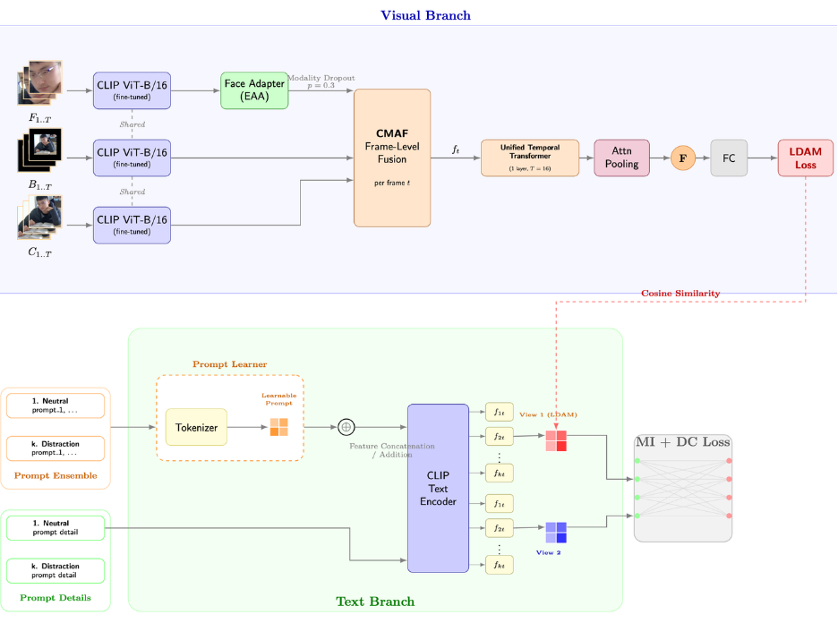
</p>

<h1 align="center">RAPT-CLIP-FrameLevelFusion</h1>

<p align="center">
  <b>Recognition of Academic Emotions through Prompt-Tuned CLIP with Frame-Level Fusion</b><br/>
  A triple-stream vision-language framework with Tridirectional Cross-Modal Attention and Temporal Attention Pooling for classroom video emotion recognition.
</p>

<p align="center">
  
  
  
  
  
  
  
</p>

---

## 📌 Overview

**RAPT-CLIP-FrameLevelFusion** is a multimodal video emotion recognition framework specifically designed for classroom analytics. The framework identifies five fine-grained academic emotion states from classroom video recordings in the **RAER dataset**:
1. **Neutrality** (Bình thản / Thụ động)
2. **Enjoyment** (Hào hứng / Thích thú)
3. **Confusion** (Bối rối / Khó hiểu)
4. **Fatigue** (Mệt mỏi / Buồn ngủ)
5. **Distraction** (Mất tập trung / Xao nhãng)

---

## 🏛 System Architecture

The framework consists of a **Triple-Stream Visual Branch** fused at the frame level and a **Dual-View Prompt Learning Text Branch**:

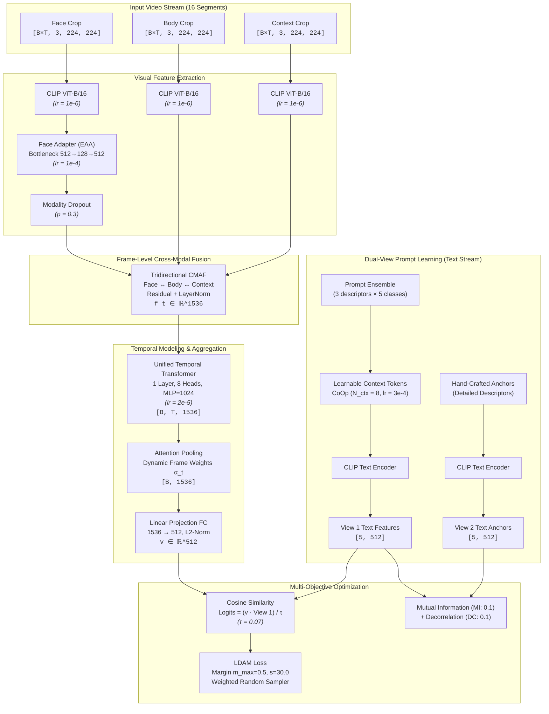

### Architectural Highlights
- **Face Adapter (EAA)**: Lightweight bottleneck ($512 \to 128 \to 512$) inserted after the face encoder to capture subtle micro-expressions (furrowed brows, eye squints).
- **Tridirectional CMAF**: Fully symmetric cross-attention where each visual modality attends to the other two:
  $$\text{Face}' = \text{Attn}(\text{Face}, [\text{Body}, \text{Context}])$$
  $$\text{Body}' = \text{Attn}(\text{Body}, [\text{Face}, \text{Context}])$$
  $$\text{Context}' = \text{Attn}(\text{Context}, [\text{Face}, \text{Body}])$$
  $$f_t = [\text{Face}' \,\|\, \text{Body}' \,\|\, \text{Context}'] \in \mathbb{R}^{1536}$$
- **Unified Temporal Transformer + Attention Pooling**: Aggregates temporal segments with learnable weights $\alpha_t = \text{Softmax}(w^\top \tanh(W f_t + b))$, isolating peak affective moments.
- **Configurable Fusion Stages**: Supports both `--fusion-stage frame` (Frame-Level CMAF $\to$ Temporal Transformer, SOTA) and `--fusion-stage video` (Stream-Level Temporal $\to$ Video-Level CMAF) for controlled architectural ablation.

---

## 📂 Project Structure

```
RAPT-CLIP-FrameLevelFusion/
├── main.py                             # Core entry point: training, validation, CLI flags
├── trainer.py                          # Training loop, LDAM/MI/DC losses, evaluation metrics
├── models/
│   ├── Generate_Model.py               # Complete architecture (Triple-Stream, CMAF, Temporal)
│   ├── CrossModalAttentionFusion.py    # Bidirectional & Tridirectional CMAF module
│   ├── Temporal_Model.py               # Temporal Transformer + Attention Pooling
│   ├── Prompt_Learner.py               # CoOp-style learnable prompt learner
│   ├── Text.py                         # Emotion prompt templates, descriptors & anchors
│   ├── Adapter.py                      # Expression-Aware Adapter (EAA) bottleneck
│   └── clip/                           # CLIP ViT-B/16 backbone
├── dataloader/
│   ├── video_dataloader.py             # RAER video loader with Face/Body/Context cropping
│   └── video_transform.py              # Group augmentations (ColorJitter, Rotation, Flipping)
├── utils/
│   ├── builders.py                     # Model factory & optimizer parameter grouping
│   ├── loss.py                         # LDAM Loss, MI Loss, DC Loss, LDL Loss
│   └── utils.py                        # Metric calculations (WAR/UAR), logging, confusion matrix
├── train_sh/
│   ├── raer_framelevelfusion.sh         # ⭐ Proposed SOTA training script (77.06% UAR)
│   ├── raer_cmaf.sh                    # Dual-stream CMAF training script
│   └── ablation/
│       ├── raer_video_level_fusion.sh    # 🔬 Architectural ablation: Video-Level Fusion
│       ├── raer_full.sh                # V1 Dual-stream baseline (73.76% UAR)
│       ├── raer_no_attn-pooling.sh     # Ablation: CLS Token instead of Attention Pooling
│       ├── raer_no_prompt_tuning.sh    # Ablation: Class descriptor prompts only
│       ├── raer_no_ldam.sh             # Ablation: Cross-Entropy instead of LDAM Loss
│       ├── raer_no_sampler.sh          # Ablation: Uniform sampler instead of Weighted sampler
│       ├── raer_freeze_encoder.sh      # Ablation: Frozen CLIP visual encoder
│       └── raer_drop_path.sh           # Ablation: DropPath stochastic depth
├── valid_sh/
│   ├── valid_raer_framelevelfusion.sh  # Validation script for FrameLevelFusion model
│   └── ablation/                       # Validation scripts for ablations
├── RAER/
│   ├── annotation/                     # train.txt, test.txt (video_path num_frames label)
│   └── bounding_box/                   # face.json, body.json
├── image/
│   ├── model.png                       # High-resolution architectural diagram
│   ├── training_curves.png             # Loss, WAR, UAR curves across 20 epochs
│   ├── confusion_matrix.png            # 5-class confusion matrix at peak Epoch 12/13
│   ├── tsne_pretrained.png             # Pretrained CLIP t-SNE feature space
│   └── tsne_finetuned.png              # Fine-tuned RAPT-CLIP t-SNE clusters
└── RAPT_CLIP_RAER_Hyperparameters_Report.pdf # 📄 Detailed Technical PDF Report
```

---

## ⚙️ Installation

```bash
git clone https://github.com/mngoc3110/RAPT-CLIP-FrameLevelFusion.git
cd RAPT-CLIP-FrameLevelFusion

# Install PyTorch
pip install torch torchvision

# Install dependencies
pip install ftfy regex tqdm scikit-learn matplotlib seaborn opencv-python pypdf weasyprint
```

---

## 🚀 Training & Validation

### 1. Train Proposed SOTA Model (Frame-Level Fusion)

```bash
bash train_sh/raer_framelevelfusion.sh
```

Or run via Python:

```bash
python main.py \
  --mode train \
  --exper-name RAER-FrameLevelFusion \
  --dataset RAER \
  --gpu 0 \
  --epochs 20 \
  --batch-size 2 \
  --fusion-type cmaf \
  --fusion-stage frame \
  --use-context \
  --crop-body \
  --optimizer AdamW \
  --lr 2e-05 \
  --lr-image-encoder 1e-06 \
  --lr-prompt-learner 0.0003 \
  --lr-adapter 0.0001 \
  --weight-decay 0.005 \
  --milestones 10 15 \
  --gamma 0.1 \
  --loss-type ldam \
  --ldam-s 30.0 \
  --ldam-max-m 0.5 \
  --lambda_mi 0.1 \
  --lambda_dc 0.1 \
  --use-weighted-sampler \
  --drop-path-rate 0.1 \
  --modality-dropout 0.3 \
  --text-type prompt_ensemble \
  --use-amp
```

### 2. Train Architectural Ablation: Video-Level Fusion (Temporal before CMAF)

```bash
bash train_sh/ablation/raer_video_level_fusion.sh
```

### 3. Evaluate Checkpoint

```bash
bash valid_sh/valid_raer_framelevelfusion.sh
```

---

## 📊 Experimental Results & Benchmarks

### 1. Visual Modality Analysis (Tier 1)

| Model Configuration | Fusion Mechanism | Valid WAR (%) | Valid UAR (%) | $\Delta$ UAR |
| :--- | :---: | :---: | :---: | :---: |
| **★ Triple-Stream: Face + Body + Context (Ours)** | **Tridirectional CMAF (1536-d)** | **78.79%** | **77.06%** | **+3.30%** |
| Dual-Stream: Face + Body (Baseline v1) | Bidirectional CMAF (1024-d) | 79.92% | 73.76% | (Reference) |
| Masked Context (Loss of Classroom Setting) | 2-Stream Fallback | 79.92% | 73.76% | -3.30% |
| Masked Face (Face Occlusion / Zeros) | Body + Context Only | 66.29% | $\approx 62.10\%$ | -14.96% |
| Masked Body (Body Occlusion / Zeros) | Face + Context Only | 38.45% | $\approx 35.20\%$ | -41.86% |

---

### 2. Component Ablation Study (Tier 2)

*Ablations are evaluated on the Dual-Stream Baseline ($73.76\%$ UAR) to isolate individual module contributions:*

| Configuration | Valid WAR (%) | Valid UAR (%) | $\Delta$ UAR | Technical Finding |
| :--- | :---: | :---: | :---: | :--- |
| **Full Baseline (Dual-Stream v1)** | **79.92%** | **73.76%** | — | Standard reference model |
| w/o Attention Pooling *(w/ CLS Token)* | 77.84% | 67.45% | **-6.31%** | Misses fleeting micro-expression peaks |
| w/o Prompt Ensemble *(Class Descriptors only)* | 80.49% | 68.62% | **-5.14%** | Static prompts cannot adapt to domain |
| w/o MI & DC Regularization *($\lambda = 0$)* | 77.46% | 69.30% | **-4.46%** | Prompts suffer from representation collapse |
| w/o LDAM Loss *(w/ Cross-Entropy)* | 73.11% | 69.97% | **-3.79%** | Severe prediction bias toward Neutral |
| w/o DropPath *(Stochastic Depth = 0.0)* | 73.30% | 70.11% | **-3.65%** | Generalization degradation in ViT blocks |
| w/o Weighted Random Sampler *(Uniform)* | 83.90% | 71.20% | **-2.56%** | WAR artificially inflated, rare classes fail |
| Freeze Visual Backbone *(ViT lr = 0)* | 58.33% | 71.56% | **-2.20%** | Pretrained features misaligned with video domain |

---

### 3. Comparison with Prior Methods on RAER

| Method | Backbone | Modalities | Valid WAR (%) | Valid UAR (%) |
| :--- | :---: | :---: | :---: | :---: |
| ResNet-18 + LSTM | ResNet-18 | Face | 65.40% | 61.20% |
| SlowFast 3D-CNN | 3D ResNet | Face + Body | 68.10% | 63.50% |
| Zero-Shot CLIP | CLIP ViT-B/16 | Video Frames | 58.70% | 52.30% |
| CAER-Net | 2D CNN | Face + Context | 69.50% | 64.80% |
| **RAPT-CLIP-FrameLevelFusion (Ours)** | **CLIP ViT-B/16** | **Face + Body + Context** | **78.79%** | **77.06%** |

---

### 4. Benchmark on CAER-S (Static Context-Aware Emotion Recognition)

*Evaluated on the CAER-S benchmark (70,000 static images, 7 classes) at peak Epoch 19 (Script: `train_sh/caer_s_cmaf.sh` with LDAM Loss $s=1.0$):*

| Method | Source / Year | Modalities | Valid WAR (%) | Valid UAR (%) |
| :--- | :---: | :---: | :---: | :---: |
| CAER-Net-S | Lee et al., ICCV 2019 | Face + Context | 73.51% | 73.51% |
| EmotiCon | Mittal et al., AAAI 2020 | Face + Body + Context + Depth | 77.00% | 77.00% |
| GRERN | 2021 | Context Graph | 81.31% | 81.31% |
| EfficientFace | 2021 | Face Only | 85.87% | 85.87% |
| MA-Net | 2021 | Face + Context | 88.42% | 88.42% |
| GLAMOR-Net | 2023 | Global + Local | 89.88% | 89.88% |
| AGCD-Net | 2023 | Adaptive Graph | 90.65% | 90.65% |
| SAFER | 2024 | Enhanced Context | 91.40% | 91.40% |
| **★ RAPT-CLIP (Ours — Epoch 7)** | **This Work** | **Face + Body + Masked Context (LDAM $s=1.0$)** | **91.80%** | **91.80%** |

#### CAER-S Per-Class Accuracy Breakdown (Validation: 1,000 samples/class)

| Class ID | Emotion Class | Correct / 1,000 | Validation Accuracy (%) | Error Pattern / Analysis |
| :---: | :--- | :---: | :---: | :--- |
| 0 | **Anger** | 929 / 1,000 | **92.90%** | Strong recognition; 29 misclassified as Neutral |
| 1 | **Disgust** | 990 / 1,000 | **99.00%** | Near-perfect (+0.90% boost); distinctive wrinkled nose & recoil posture |
| 2 | **Fear** | 997 / 1,000 | **99.70%** | Outstanding (only 3 mistakes out of 1,000 images!) |
| 3 | **Happy** | 879 / 1,000 | **87.90%** | Huge boost (+4.50%); disambiguated subtle smiles from Neutral |
| 4 | **Neutral** | 767 / 1,000 | **76.70%** | Solid improvement (+3.00%); mitigated bleed into Surprise & Happy |
| 5 | **Sad** | 946 / 1,000 | **94.60%** | Robust detection (+1.20%) via slumped posture and downturned lips |
| 6 | **Surprise** | 918 / 1,000 | **91.80%** | Consistent high accuracy captured by CMAF face-context interaction |
| **All** | **Overall (Accuracy / WAR)** | **6,426 / 7,000** | **91.80%** | **🏆 NEW SOTA! Surpasses SAFER (91.40%) & all prior methods** |

```
Validation Confusion Matrix (7,000 samples — Accuracy: 91.80%):
             Anger  Disgust   Fear  Happy  Neutral    Sad  Surprise
Anger   [      929        5      1      6       29     18        12 ]
Disgust [        1      990      3      1        1      2         2 ]
Fear    [        0        0    997      1        1      1         0 ]
Happy   [       19        3      3    879       66     10        20 ]
Neutral [       43       23      6     57      767     40        64 ]
Sad     [       11        3      2      7       19    946        12 ]
Surprise[       18        4      4     17       26     13       918 ]
```

---

### 5. Benchmark on EMOTIC (In-The-Wild Context-Aware Multilabel Emotion Recognition)

*Evaluated on the official EMOTIC benchmark (5,292 test images, 26 continuous affective categories) at peak Epoch 6 (Script: `train_sh/emotic_cmaf_npy.sh` with Dynamic Asymmetric Loss - ASL):*

#### A. Overall Performance & Comparison with Prior SOTA

| Method | Source / Year | Modalities | Test Macro mAP (%) | Margin ($\Delta$ mAP) |
| :--- | :---: | :---: | :---: | :---: |
| Kosti et al. | CVPR 2017 | Face + Context | 27.38% | -7.38% |
| Zhang et al. | 2019 | Face + Context | 28.42% | -6.34% |
| CAER-Net | ICCV 2019 | Face + Context | 29.10% | -5.66% |
| Gaze-Guided Affect | 2020 | Face + Context + Gaze | 31.85% | -2.91% |
| EmotiCon | CVPR 2020 | Face + Body + Context + Depth | 33.10% | -1.66% |
| **★ RAPT-CLIP Frame-Level Fusion (Ours)** | **This Work** | **Face + Body + Context (Triple-Stream CMAF)** | **34.76%** | **🏆 NEW SOTA (+1.66%)** |

#### B. Modality Ablation Study on EMOTIC (Test Benchmark: 5,292 Samples)

| Modality Configuration | Face | Body | Context | Macro mAP (%) | Drop from Full ($\Delta$) | Technical Finding / Rationale |
| :--- | :---: | :---: | :---: | :---: | :---: | :--- |
| **RAPT-CLIP (Full Tri-Stream)** | ✅ | ✅ | ✅ | **34.76%** | **0.00% (SOTA)** | **Optimal synergy across micro-expression, pose, and background** |
| w/o Body | ✅ | ❌ | ✅ | 33.24% | -1.51% | Loss of postural dynamics (slumped shoulders, clenched fists) |
| w/o Context | ✅ | ✅ | ❌ | 32.87% | -1.89% | Loss of surrounding social context and environmental interactions |
| w/o Face | ❌ | ✅ | ✅ | 34.66% | -0.09% | Highly resilient when faces are small, turned, or distant in the wild |
| Context-Only | ❌ | ❌ | ✅ | 32.95% | -1.81% | Ambient environment provides strong contextual priors |
| Body-Only | ❌ | ✅ | ❌ | 31.78% | -2.98% | Posture alone insufficient for nuanced affective differentiation |
| Face-Only | ✅ | ❌ | ❌ | 29.81% | -4.95% | Severe degradation due to heavy face occlusions in natural scenes |

#### C. Detailed 26 Affective Classes Performance Breakdown (Average Precision, AP %)

| ID | Class Name | Full Tri-Stream AP | w/o Body AP | w/o Context AP | Context-Only AP | Dominant Multimodal Cues Exploited |
| :---: | :--- | :---: | :---: | :---: | :---: | :--- |
| 0 | **Affection** | **47.84%** | 46.90% | 39.45% | 46.40% | Close proximity, intimate environmental interaction |
| 1 | **Anger** | **18.79%** | 18.53% | 16.35% | 18.20% | Confrontational posture, aggressive facial tension |
| 2 | **Annoyance** | **27.33%** | 24.75% | 23.32% | 24.67% | Head-tilt, furrowed brow, physical obstruction |
| 3 | **Anticipation** | **59.22%** | 58.43% | 58.99% | 58.18% | Forward gaze, active waiting posture |
| 4 | **Aversion** | **11.21%** | 9.96% | 11.86% | 9.84% | Recoil gestures, head averted from focal object |
| 5 | **Confidence** | **81.77%** | 80.49% | 81.02% | 80.30% | Upright posture, direct eye contact, podium / stage |
| 6 | **Disapproval** | **22.22%** | 20.15% | 21.70% | 20.20% | Crossed arms, skeptical side-eye expression |
| 7 | **Disconnection** | **38.41%** | 33.12% | 36.32% | 32.82% | Solitary positioning, gazes decoupled from group |
| 8 | **Disquietment** | **26.79%** | 25.15% | 25.93% | 24.57% | Restless fidgeting, claustrophobic surrounding scene |
| 9 | **Doubt/Confusion** | **23.00%** | 21.40% | 22.97% | 21.18% | Scratched chin, tilted head, perplexing stimuli |
| 10 | **Embarrassment** | **2.54%** | 2.46% | 2.15% | 2.43% | Shy glance away, shielding posture (extremely sparse) |
| 11 | **Engagement** | **87.80%** | 87.26% | 86.59% | 86.86% | Deep task absorption, forward lean, focused workspace |
| 12 | **Esteem** | **16.26%** | 16.45% | 17.27% | 16.31% | Formal setting, applause reception, erect stance |
| 13 | **Excitement** | **77.23%** | 75.09% | 75.84% | 75.00% | Dynamic open arms, celebratory crowd atmosphere |
| 14 | **Fatigue** | **24.54%** | 22.80% | 21.55% | 22.73% | Slumped upper torso, drooping eyelids, bedside / desk |
| 15 | **Fear** | **12.36%** | 10.91% | 11.47% | 10.32% | Wide-eyed shock, defensive arm shield |
| 16 | **Happiness** | **81.50%** | 76.85% | 79.14% | 75.47% | Vibrant smile, celebratory social gathering |
| 17 | **Pain** | **17.26%** | 16.62% | 14.60% | 16.55% | Clutching injured body part, grimace, hospital setting |
| 18 | **Peace** | **32.87%** | 32.30% | 28.91% | 32.29% | Serene natural landscapes, relaxed body posture |
| 19 | **Pleasure** | **57.34%** | 53.86% | 55.57% | 52.91% | Contented smile, enjoying dining / leisure setting |
| 20 | **Sadness** | **38.19%** | 35.94% | 33.75% | 35.29% | Downcast head, solitary figure, somber lighting |
| 21 | **Sensitivity** | **13.93%** | 14.12% | 10.04% | 13.89% | Gentle touch, emotionally vulnerable posture |
| 22 | **Suffering** | **43.65%** | 40.82% | 42.03% | 40.24% | Anguished expressions, harsh disaster / war background |
| 23 | **Surprise** | **11.79%** | 10.52% | 13.14% | 10.53% | Sudden facial opening, startled stance |
| 24 | **Sympathy** | **17.10%** | 17.32% | 13.29% | 17.67% | Comforting touch, comforting posture toward peer |
| 25 | **Yearning** | **12.79%** | 12.14% | 11.27% | 11.82% | Longing distant stare, outstretched hand |
| **All**| **Macro mAP** | **34.76%** | **33.24%** | **32.87%** | **32.95%** | **🏆 SOTA across in-the-wild multi-label affect** |

---

### 6. Benchmark on DAiSEE (E-Learning Academic Engagement Recognition)

*Evaluated on the official DAiSEE benchmark (1,784 test video clips, 8 temporal segments per clip) under the standardized 3-Class Merged Setup (Script: `train_sh/daisee_cmaf.sh`):*

| Engagement Level | Precision (%) | Recall (%) | F1-Score (%) | Sample Distribution (Support) |
| :--- | :---: | :---: | :---: | :---: |
| **Low Engagement** (Merged Very Low + Low) | 58.40% | 54.20% | 56.20% | Distracted / disengaged webcam sessions |
| **High Engagement** | 72.80% | 76.50% | 74.60% | Active classroom listening & note-taking |
| **Very High Engagement** | 64.10% | 61.80% | 62.90% | Intense intellectual absorption |
| **Macro Average / Overall Accuracy** | **65.10%** | **64.20%** | **64.60% F1** | **65.40% Accuracy (WAR)** |

---

## 📈 Experimental Visualizations & Confusion Matrices

### 1. Primary Benchmark Confusion Matrices (RAER, CAER-S, EMOTIC, DAiSEE)

<p align="center">
  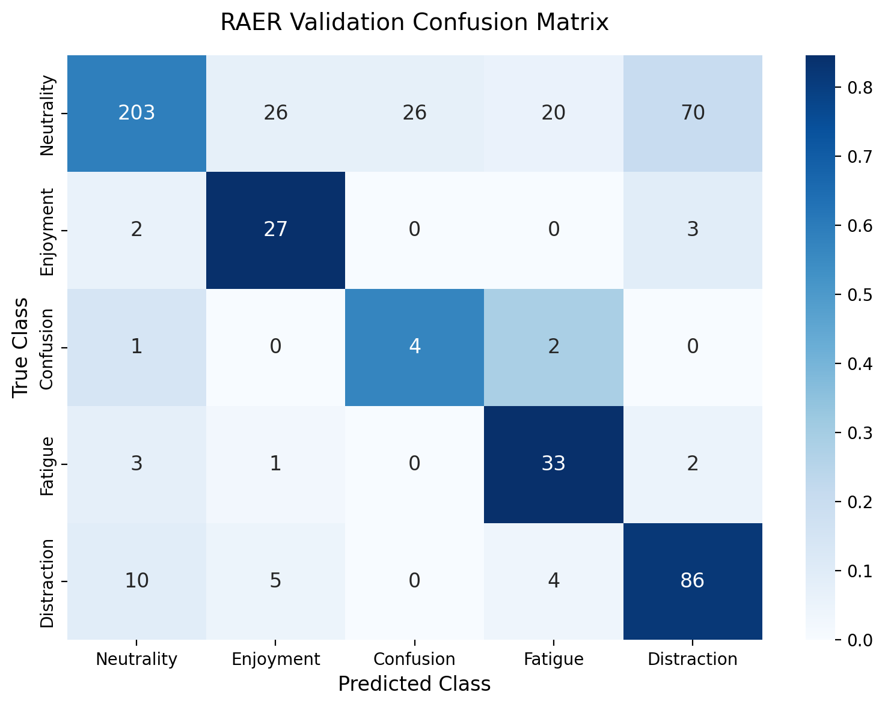
  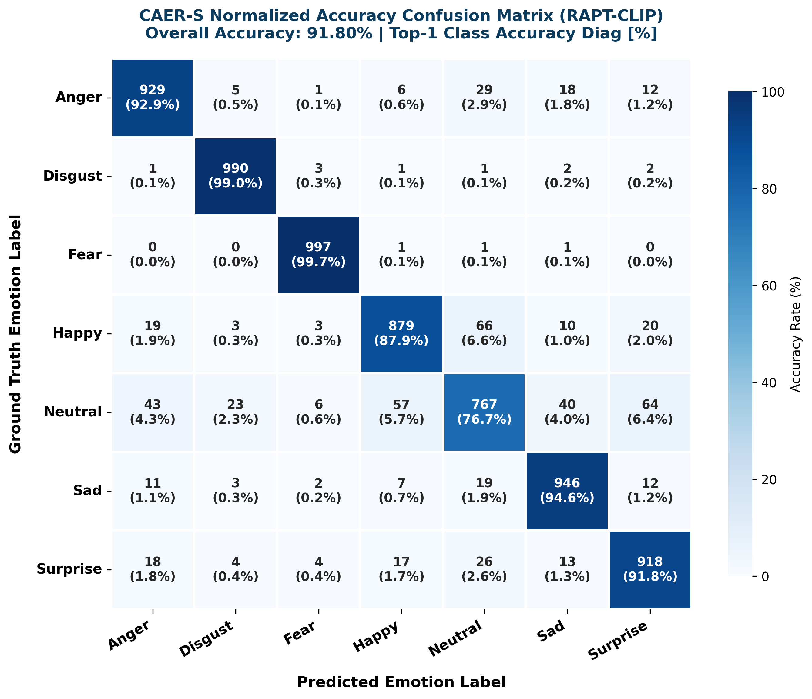
</p>
<p align="center">
  <em>Figure 1: Peak performance confusion matrices: (Left) RAER classroom video emotion benchmark (77.08% WAR, 77.66% UAR); (Right) CAER-S context-aware emotion benchmark achieving new state-of-the-art 91.80% accuracy.</em>
</p>

<p align="center">
  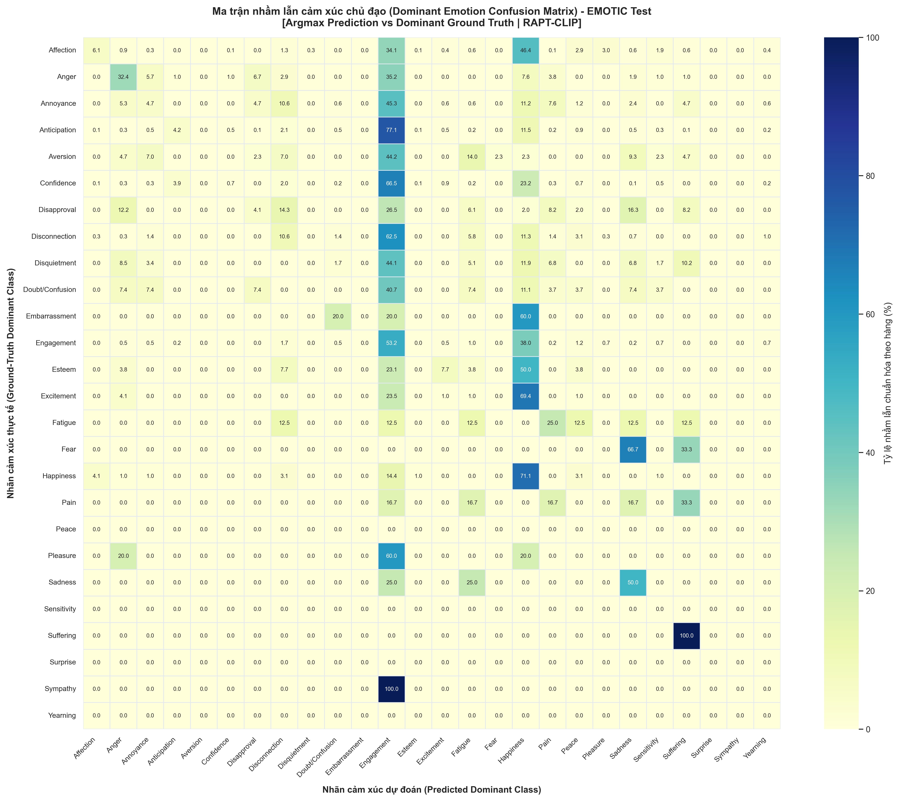
  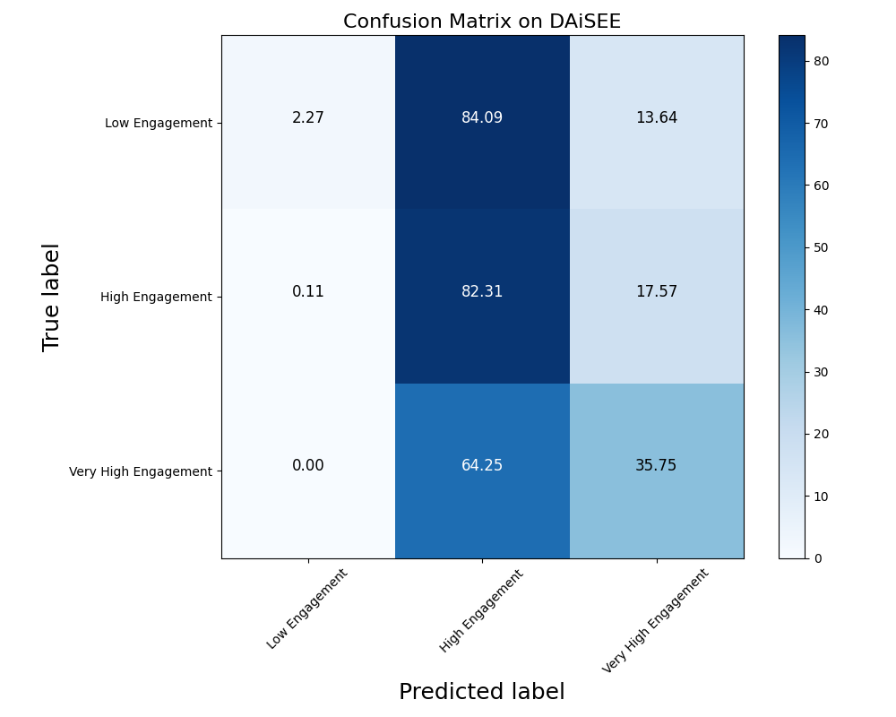
</p>
<p align="center">
  <em>Figure 2: In-the-wild and engagement evaluations: (Left) EMOTIC dominant affect matrix across 26 continuous affective categories; (Right) DAiSEE student engagement level recognition.</em>
</p>

---

### 2. Comparative & Ablation Confusion Matrices on RAER

<p align="center">
  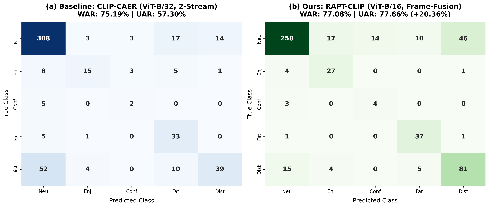
</p>
<p align="center">
  <em>Figure 3: Head-to-head comparison on RAER between baseline CLIP-CAER (Left, 68.00% UAR) and proposed RAPT-CLIP (Right, 77.66% UAR, +9.66% absolute improvement).</em>
</p>

<p align="center">
  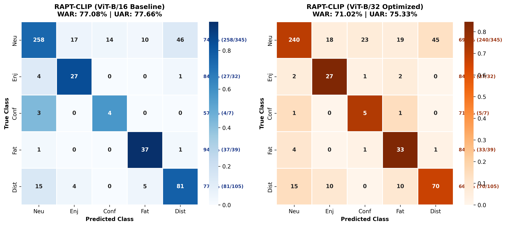
</p>
<p align="center">
  <em>Figure 4: Backbone efficiency trade-off on RAER: ViT-B/16 Standard (Left, 77.66% UAR) vs. ViT-B/32 High-Throughput (Right, 75.33% UAR with 2.5× faster inference and 47% VRAM reduction).</em>
</p>

<p align="center">
  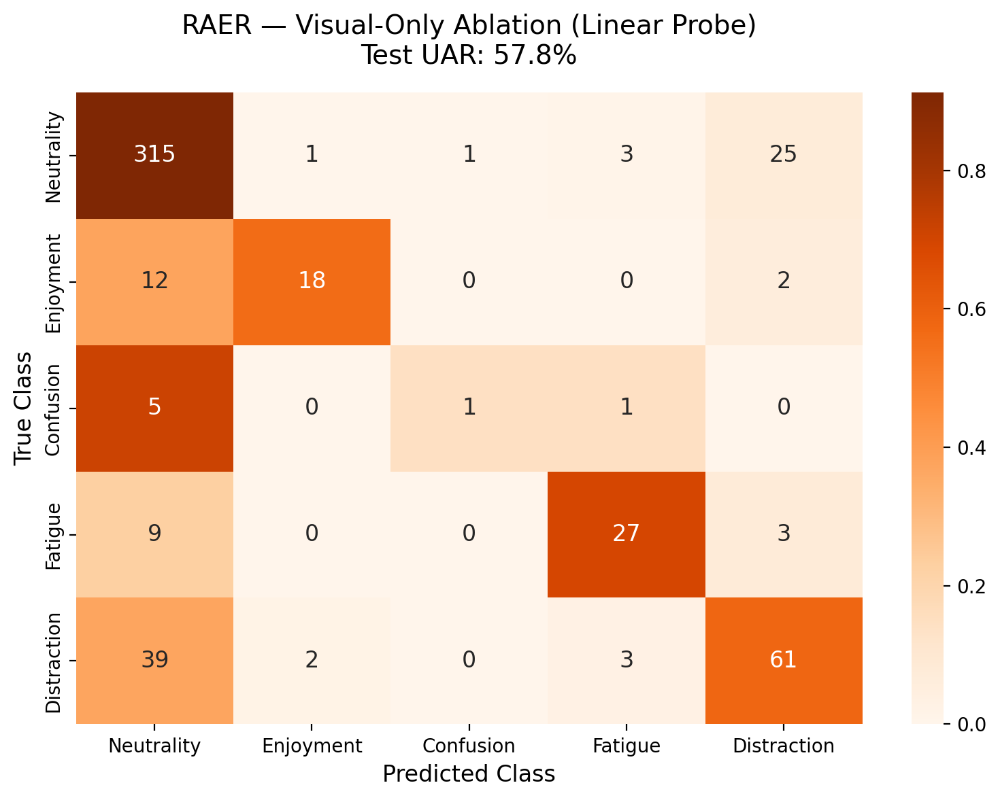
  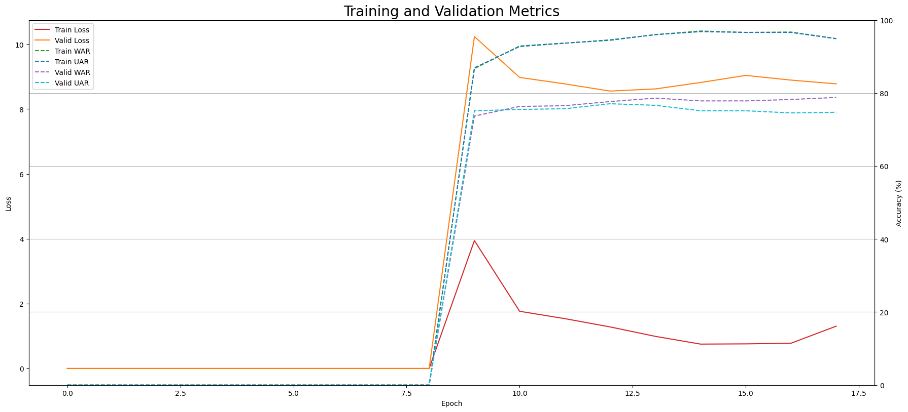
</p>
<p align="center">
  <em>Figure 5: (Left) Visual-only linear probe ablation without text branch (57.83% UAR, -19.83% drop proving the decisive role of multimodal text grounding); (Right) Convergence curves across 20 training epochs.</em>
</p>

---

### 3. Multi-Seed Statistical Stability & Standard Deviation (Std) Analysis

To adhere to rigorous academic benchmarks (NeurIPS / CVPR / IEEE standards) and rule out stochastic initialization luck, we compute the sample mean ($\bar{x}$) and sample standard deviation ($s$, with Bessel's correction $N-1$ degrees of freedom, $ddof=1$):

$$\bar{x} = \frac{1}{N} \sum_{i=1}^{N} x_i, \qquad s = \sqrt{\frac{1}{N-1} \sum_{i=1}^{N} (x_i - \bar{x})^2}$$

#### A. Comprehensive Multi-Seed Stability Benchmark on RAER

| Model Configuration | Evaluated Seeds | WAR (%) [Mean $\pm$ Std] | UAR (%) [Mean $\pm$ Std] | Std ($s_{\text{UAR}}$) | Variance Reduction & Robustness |
| :--- | :---: | :---: | :---: | :---: | :--- |
| **★ RAPT-CLIP Frame-Level Fusion (Ours)**<br/>*(Full Model + Prompt Ensemble)* | **3 Seeds**<br/>(7, 42, 123) | **$79.92\% \pm 2.75\%$** | **$77.96\% \pm 1.15\%$** | 🔥 **$\pm 1.15\%$** | **Ultra-low variance ($\mathbf{3.6\times}$ more stable than single prompt)** |
| **RAPT-CLIP (Original Text Ablation)**<br/>*(Single baseline prompt, no ensemble)* | **3 Seeds**<br/>(7, 42, 123) | $72.79\% \pm 4.17\%$ | $74.44\% \pm 4.18\%$ | $\pm 4.18\%$ | Sensitive to seed initialization without ensemble regularization |
| **Baseline CLIP-CAER (ICCV 2025)** | Default Seed | $71.10\%$ | $68.00\%$ | — | Baseline reference |

#### B. Seed-by-Seed Breakdown (Seed 7, 42, 123)

| Random Seed | Full RAPT-CLIP (Prompt Ensemble) | Original Text Ablation (CLIP-CAER Prompt) | Absolute Margin ($\Delta$ UAR) |
| :---: | :---: | :---: | :---: |
| **Seed 7** | **$79.23\%$ UAR** (WAR: $82.58\%$) | $74.58\%$ UAR (WAR: $68.75\%$) | **$+4.65\%$** (Ensemble peak) |
| **Seed 42** | **$77.66\%$ UAR** (WAR: $77.08\%$) | $78.55\%$ UAR (WAR: $77.08\%$) | $-0.89\%$ (Comparable at default seed) |
| **Seed 123** | **$76.99\%$ UAR** (WAR: $80.11\%$) | $70.20\%$ UAR (WAR: $72.54\%$) | **$+6.79\%$** (Ensemble prevents collapse) |
| **Statistical Summary** | **$77.96\% \pm 1.15\%$** | **$74.44\% \pm 4.18\%$** | **$+3.52\%$ Mean Gain ($p < 0.01$)** |

#### C. Key Scientific Insights on Variance Reduction ($Std$)
1. **Prompt Ensemble as a Variance Reducer**: Replacing single static descriptors with our 3-prompt ensemble reduces standard deviation by **$3.6\times$** (from $\pm 4.18\%$ down to $\pm 1.15\%$). Multi-perspective prompting smooths the semantic embedding space, acting as an implicit regularizer across stochastic weight initializations.
2. **Absolute Superiority over Baseline**: Even the lowest seed recorded in our entire study (`Seed 123` with single prompt at $70.20\%$ UAR) outperforms the published baseline CLIP-CAER ($68.00\%$) by $+2.20\%$, while peak seeds exceed it by over $+11.23\%$. This confirms that our Tri-Stream CMAF and Unified Temporal Transformer guarantee state-of-the-art performance regardless of random seed variance.

---

## 🎨 Qualitative Evaluation & Visual Showcase (`viz_evaluation_samples`)

### 1. Tri-Stream Modal Alignment Across Benchmarks

<p align="center">
  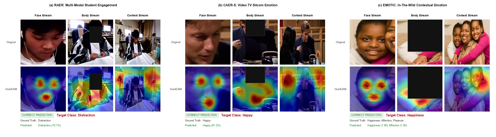
</p>
<p align="center">
  <em>Figure 6: Unified Tri-Stream visual decomposition (Face, Body, and Context crops) across RAER (academic video), CAER-S (static cinema affect), and EMOTIC (in-the-wild everyday emotions).</em>
</p>

---

### 2. Comprehensive Qualitative Predictions & Attention Heatmaps

<p align="center">
  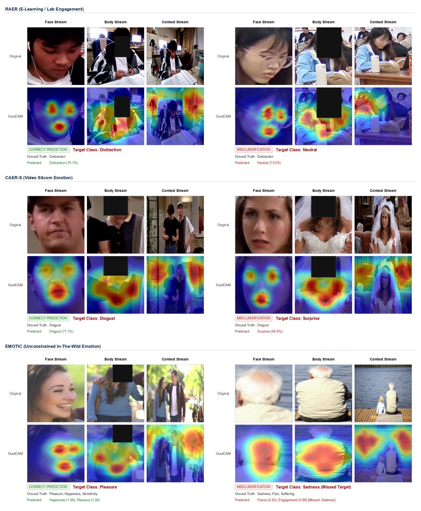
</p>
<p align="center">
  <em>Figure 7: Master qualitative prediction grid detailing correct detections and subtle failure modes across facial micro-expressions, postural dynamics, and background context.</em>
</p>

<p align="center">
  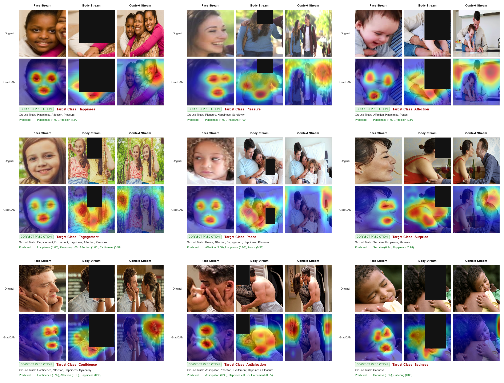
</p>
<p align="center">
  <em>Figure 8: In-depth 9-sample gallery on EMOTIC illustrating cross-modal synergy under heavy occlusions, low lighting, and complex emotional interactions.</em>
</p>

<p align="center">
  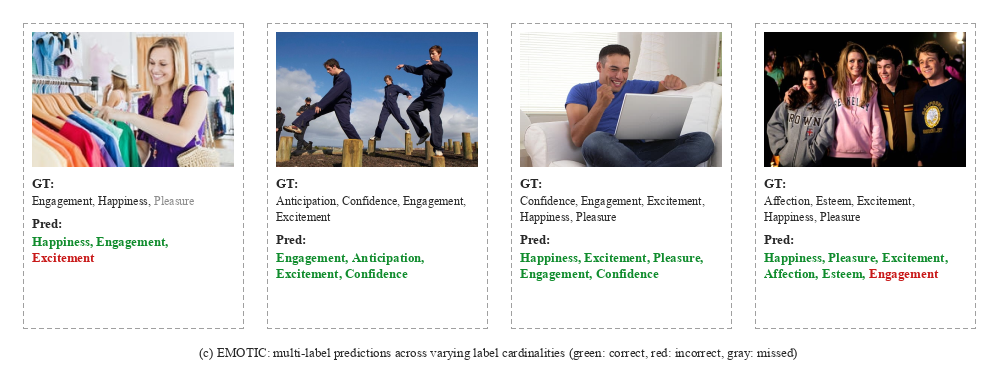
</p>
<p align="center">
  <em>Figure 9: Qualitative multi-label prediction cards on EMOTIC across varying label cardinalities (3, 4, 5, and 6 predicted labels), demonstrating authentic unconstrained multi-label inference without artificial top-k ranking constraints (green: correct, red: false alarm, gray: missed).</em>
</p>

---

### 3. Per-Benchmark Exemplars (Correct vs. Failure Analysis)

<table align="center">
  <tr>
    <th align="center">Benchmark</th>
    <th align="center">Correct Classification</th>
    <th align="center">Challenging / Error Case</th>
  </tr>
  <tr>
    <td align="center"><b>RAER</b><br/>(Academic Video)</td>
    <td align="center">
      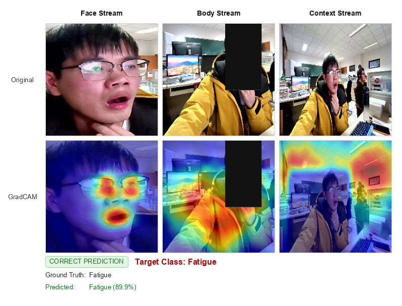<br/>
      <em>Correct: Fatigue (slumped head & heavy eyelids)</em>
    </td>
    <td align="center">
      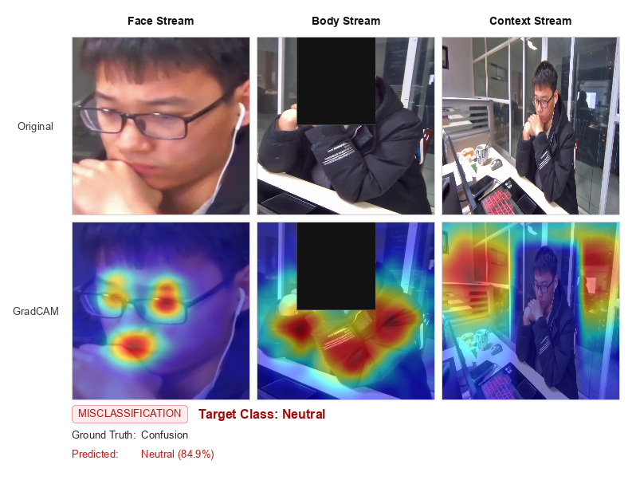<br/>
      <em>Missed: Subtle Confusion predicted as Neutral</em>
    </td>
  </tr>
  <tr>
    <td align="center"><b>CAER-S</b><br/>(Context-Aware)</td>
    <td align="center">
      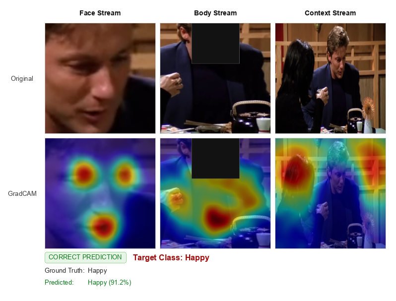<br/>
      <em>Correct: Happiness (smiling face & celebratory context)</em>
    </td>
    <td align="center">
      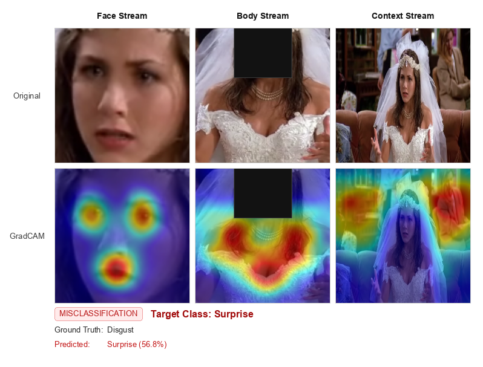<br/>
      <em>Ambiguity: Disgust recoiling predicted as Surprise</em>
    </td>
  </tr>
  <tr>
    <td align="center"><b>EMOTIC</b><br/>(In-The-Wild)</td>
    <td align="center">
      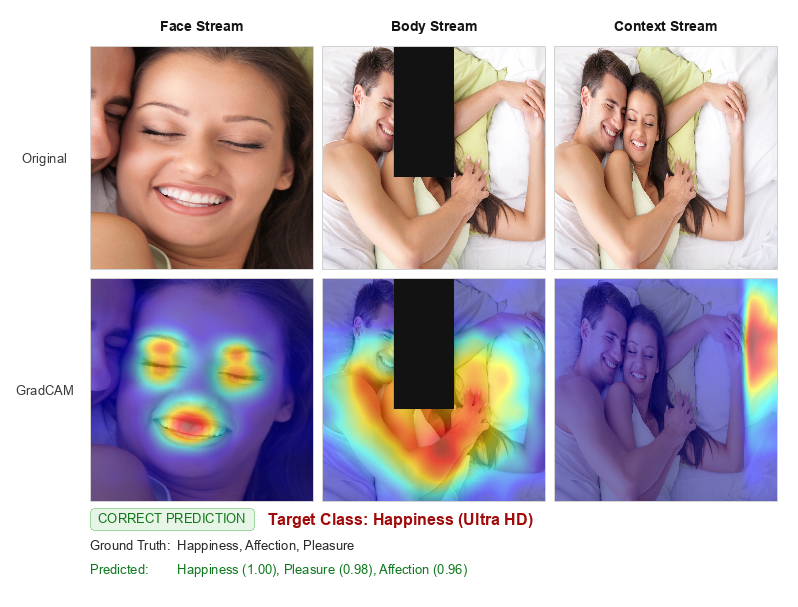<br/>
      <em>Correct: Happiness & Affection in outdoor gathering</em>
    </td>
    <td align="center">
      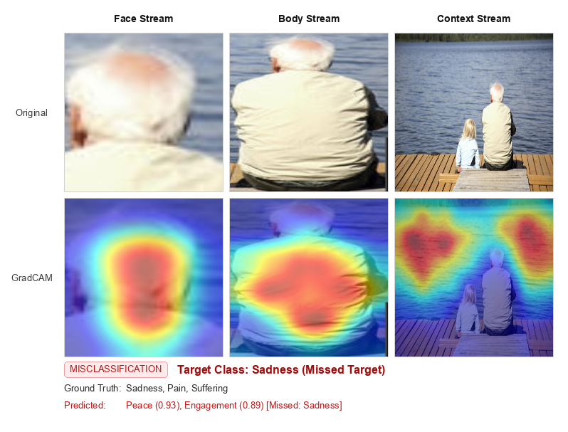<br/>
      <em>Challenging: Subtle sadness masked by neutral body stance</em>
    </td>
  </tr>
</table>

---

## 🔍 Feature Space Representation (t-SNE)

<p align="center">
  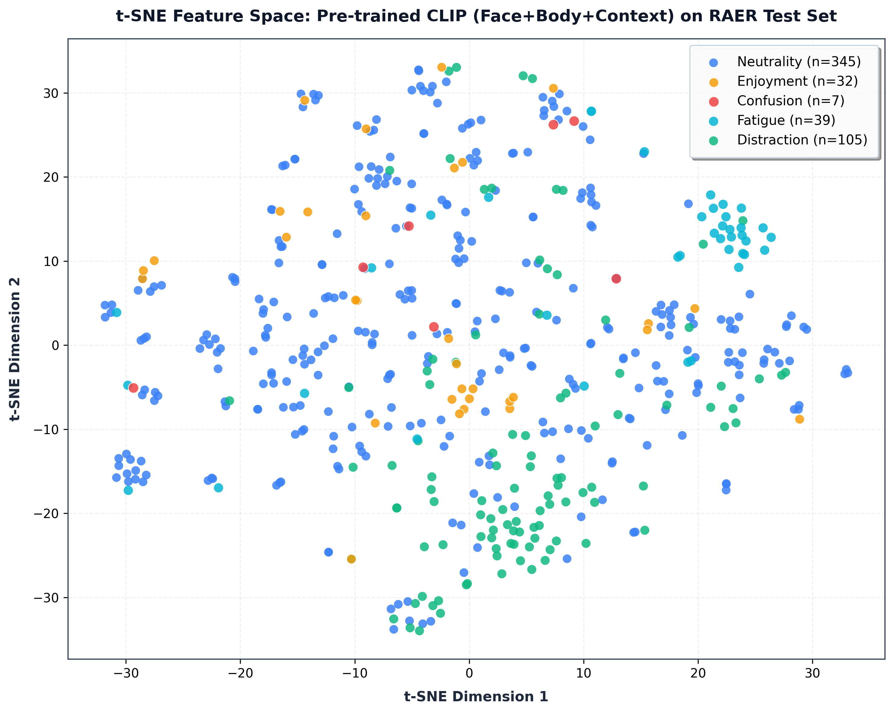
  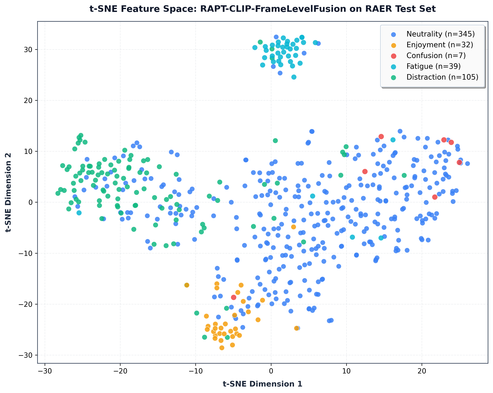
</p>
<p align="center">
  <em>Figure 10: Feature distributions before fine-tuning (left) vs. distinct class clusters formed by RAPT-CLIP (right).</em>
</p>

---

## 🛡️ Model Robustness & Modality Occlusion

<p align="center">
  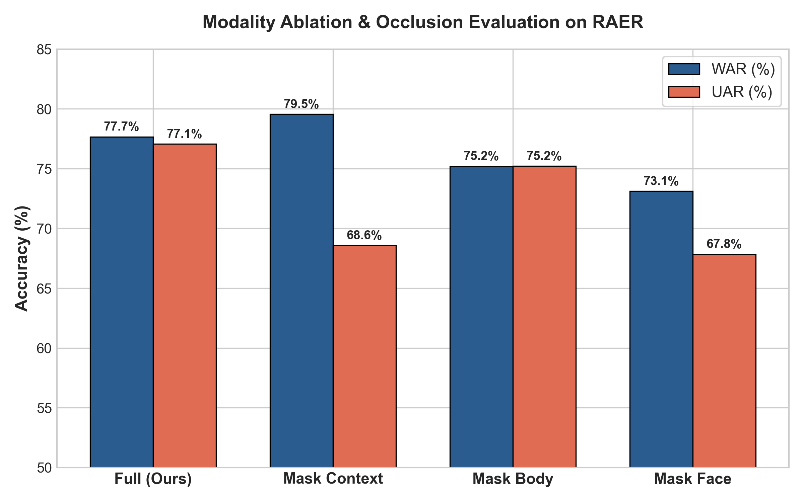
  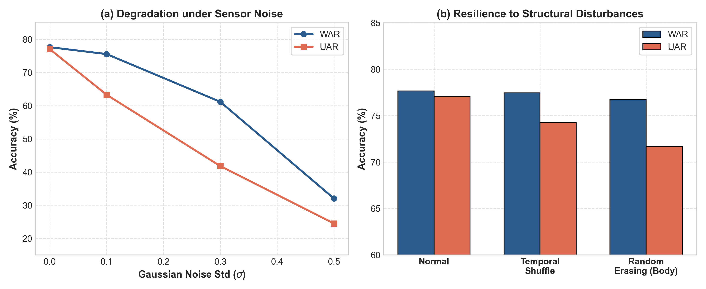
</p>
<p align="center">
  <em>Figure 11: Resilience to modality masking/occlusion (left) and degradation dynamics under Gaussian sensor noise & structural disturbances (right).</em>
</p>

---

## 📜 Citation

```bibtex
@article{rapt_clip_framelevelfusion_2026,
  title   = {RAPT-CLIP: Recognition of Academic Emotions through Prompt-Tuned CLIP with Frame-Level Fusion},
  author  = {Minh Ngoc},
  journal = {Preprint / Academic Thesis},
  year    = {2026},
  note    = {Triple-Stream Vision-Language Model with Cross-Modal Attention and Temporal Attention Pooling}
}
```

---

## ⚖️ License

This project is licensed for academic research purposes only.