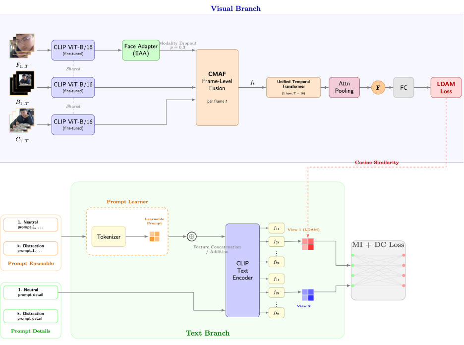
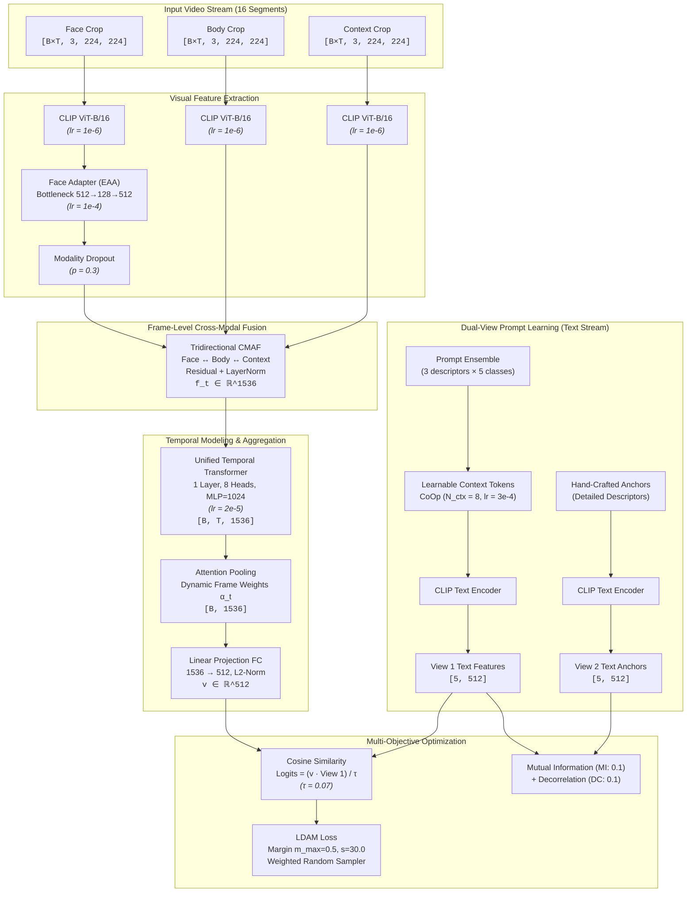
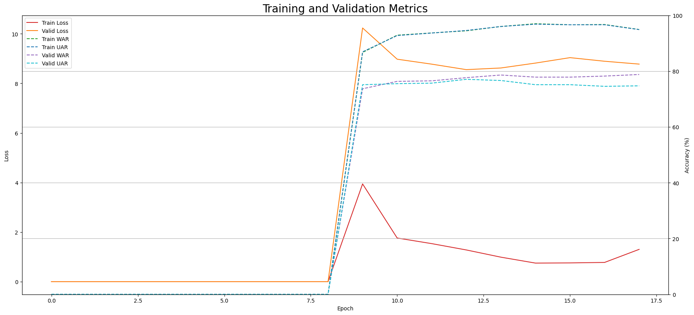
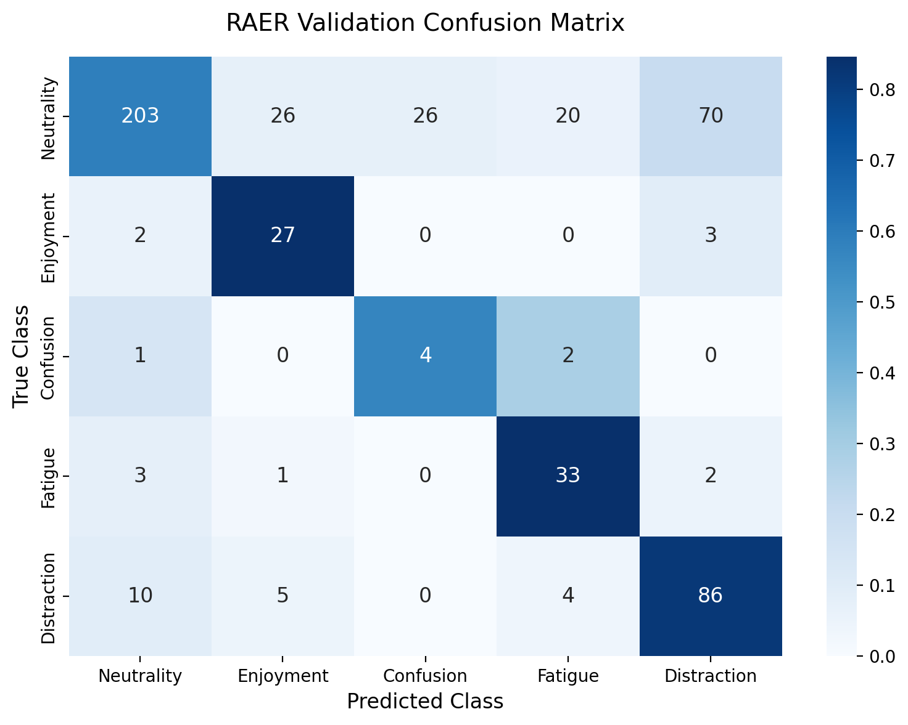
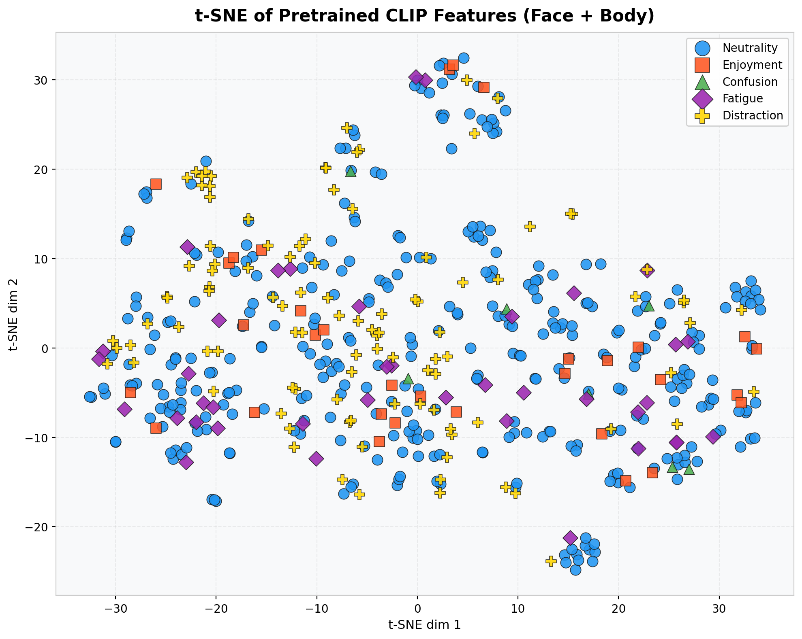
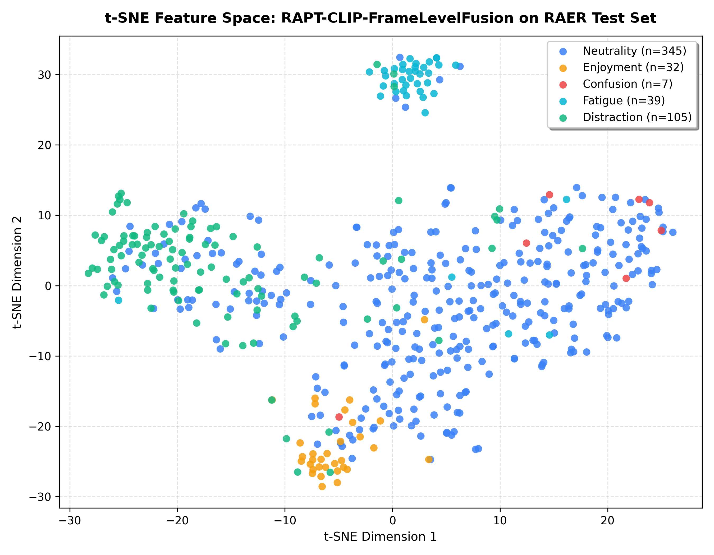
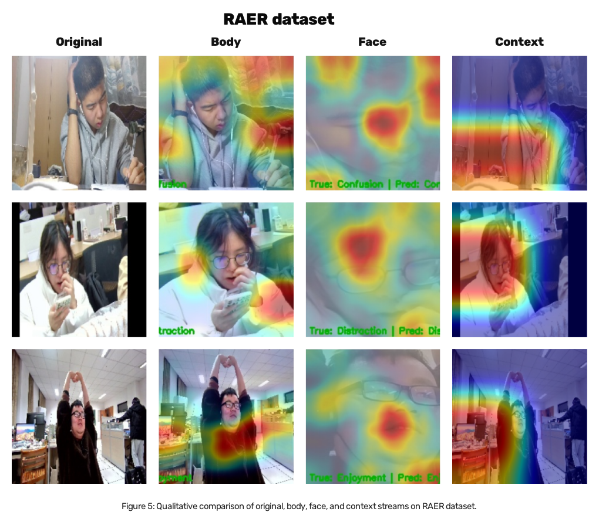
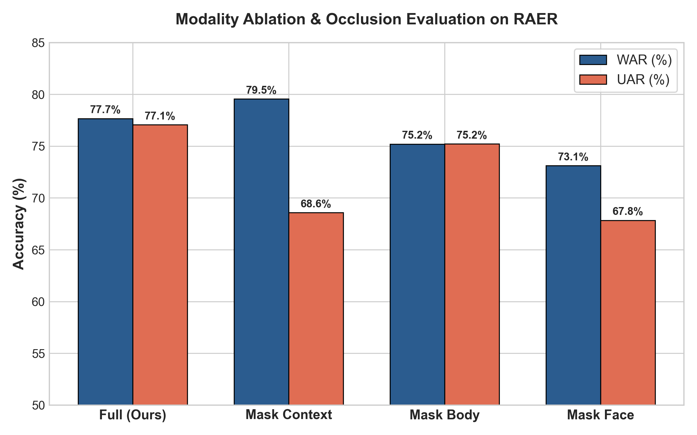
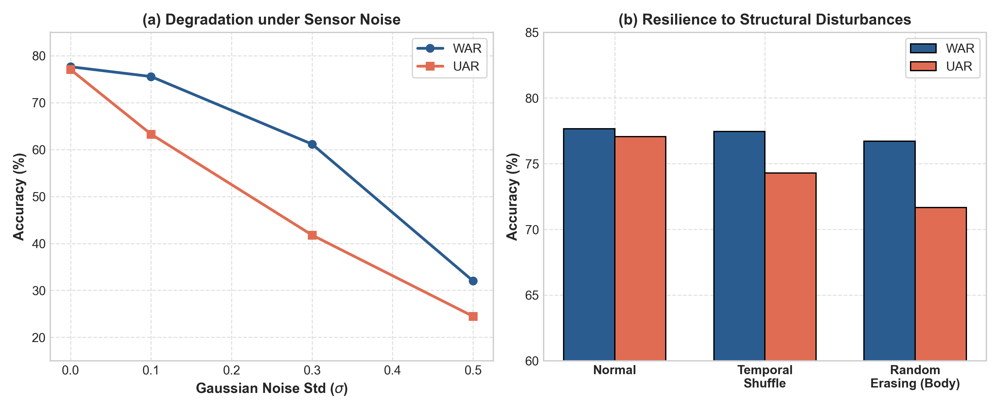

<p align="center">
  
</p>

<h1 align="center">RAPT-CLIP-FrameLevelFusion</h1>

<p align="center">
  <b>Recognition of Academic Emotions through Prompt-Tuned CLIP with Frame-Level Fusion</b><br/>
  A triple-stream vision-language framework with Tridirectional Cross-Modal Attention and Temporal Attention Pooling for classroom video emotion recognition.
</p>

<p align="center">
  
  
  
  
  
  
  
</p>

---

## 📌 Overview

**RAPT-CLIP-FrameLevelFusion** is a multimodal video emotion recognition framework specifically designed for classroom analytics. The framework identifies five fine-grained academic emotion states from classroom video recordings in the **RAER dataset**:
1. **Neutrality** (Bình thản / Thụ động)
2. **Enjoyment** (Hào hứng / Thích thú)
3. **Confusion** (Bối rối / Khó hiểu)
4. **Fatigue** (Mệt mỏi / Buồn ngủ)
5. **Distraction** (Mất tập trung / Xao nhãng)

---

## 🏛 System Architecture

The framework consists of a **Triple-Stream Visual Branch** fused at the frame level and a **Dual-View Prompt Learning Text Branch**:



### Architectural Highlights
- **Face Adapter (EAA)**: Lightweight bottleneck ($512 \to 128 \to 512$) inserted after the face encoder to capture subtle micro-expressions (furrowed brows, eye squints).
- **Tridirectional CMAF**: Fully symmetric cross-attention where each visual modality attends to the other two:
  $$\text{Face}' = \text{Attn}(\text{Face}, [\text{Body}, \text{Context}])$$
  $$\text{Body}' = \text{Attn}(\text{Body}, [\text{Face}, \text{Context}])$$
  $$\text{Context}' = \text{Attn}(\text{Context}, [\text{Face}, \text{Body}])$$
  $$f_t = [\text{Face}' \,\|\, \text{Body}' \,\|\, \text{Context}'] \in \mathbb{R}^{1536}$$
- **Unified Temporal Transformer + Attention Pooling**: Aggregates temporal segments with learnable weights $\alpha_t = \text{Softmax}(w^\top \tanh(W f_t + b))$, isolating peak affective moments.
- **Configurable Fusion Stages**: Supports both `--fusion-stage frame` (Frame-Level CMAF $\to$ Temporal Transformer, SOTA) and `--fusion-stage video` (Stream-Level Temporal $\to$ Video-Level CMAF) for controlled architectural ablation.

---

## 📂 Project Structure

```
RAPT-CLIP-FrameLevelFusion/
├── main.py                             # Core entry point: training, validation, CLI flags
├── trainer.py                          # Training loop, LDAM/MI/DC losses, evaluation metrics
├── models/
│   ├── Generate_Model.py               # Complete architecture (Triple-Stream, CMAF, Temporal)
│   ├── CrossModalAttentionFusion.py    # Bidirectional & Tridirectional CMAF module
│   ├── Temporal_Model.py               # Temporal Transformer + Attention Pooling
│   ├── Prompt_Learner.py               # CoOp-style learnable prompt learner
│   ├── Text.py                         # Emotion prompt templates, descriptors & anchors
│   ├── Adapter.py                      # Expression-Aware Adapter (EAA) bottleneck
│   └── clip/                           # CLIP ViT-B/16 backbone
├── dataloader/
│   ├── video_dataloader.py             # RAER video loader with Face/Body/Context cropping
│   └── video_transform.py              # Group augmentations (ColorJitter, Rotation, Flipping)
├── utils/
│   ├── builders.py                     # Model factory & optimizer parameter grouping
│   ├── loss.py                         # LDAM Loss, MI Loss, DC Loss, LDL Loss
│   └── utils.py                        # Metric calculations (WAR/UAR), logging, confusion matrix
├── train_sh/
│   ├── raer_framelevelfusion.sh         # ⭐ Proposed SOTA training script (77.06% UAR)
│   ├── raer_cmaf.sh                    # Dual-stream CMAF training script
│   └── ablation/
│       ├── raer_video_level_fusion.sh    # 🔬 Architectural ablation: Video-Level Fusion
│       ├── raer_full.sh                # V1 Dual-stream baseline (73.76% UAR)
│       ├── raer_no_attn-pooling.sh     # Ablation: CLS Token instead of Attention Pooling
│       ├── raer_no_prompt_tuning.sh    # Ablation: Class descriptor prompts only
│       ├── raer_no_ldam.sh             # Ablation: Cross-Entropy instead of LDAM Loss
│       ├── raer_no_sampler.sh          # Ablation: Uniform sampler instead of Weighted sampler
│       ├── raer_freeze_encoder.sh      # Ablation: Frozen CLIP visual encoder
│       └── raer_drop_path.sh           # Ablation: DropPath stochastic depth
├── valid_sh/
│   ├── valid_raer_framelevelfusion.sh  # Validation script for FrameLevelFusion model
│   └── ablation/                       # Validation scripts for ablations
├── RAER/
│   ├── annotation/                     # train.txt, test.txt (video_path num_frames label)
│   └── bounding_box/                   # face.json, body.json
├── image/
│   ├── model.png                       # High-resolution architectural diagram
│   ├── training_curves.png             # Loss, WAR, UAR curves across 20 epochs
│   ├── confusion_matrix.png            # 5-class confusion matrix at peak Epoch 12/13
│   ├── tsne_pretrained.png             # Pretrained CLIP t-SNE feature space
│   └── tsne_finetuned.png              # Fine-tuned RAPT-CLIP t-SNE clusters
└── RAPT_CLIP_RAER_Hyperparameters_Report.pdf # 📄 Detailed Technical PDF Report
```

---

## ⚙️ Installation

```bash
git clone https://github.com/mngoc3110/RAPT-CLIP-FrameLevelFusion.git
cd RAPT-CLIP-FrameLevelFusion

# Install PyTorch
pip install torch torchvision

# Install dependencies
pip install ftfy regex tqdm scikit-learn matplotlib seaborn opencv-python pypdf weasyprint
```

---

## 🚀 Training & Validation

### 1. Train Proposed SOTA Model (Frame-Level Fusion)

```bash
bash train_sh/raer_framelevelfusion.sh
```

Or run via Python:

```bash
python main.py \
  --mode train \
  --exper-name RAER-FrameLevelFusion \
  --dataset RAER \
  --gpu 0 \
  --epochs 20 \
  --batch-size 2 \
  --fusion-type cmaf \
  --fusion-stage frame \
  --use-context \
  --crop-body \
  --optimizer AdamW \
  --lr 2e-05 \
  --lr-image-encoder 1e-06 \
  --lr-prompt-learner 0.0003 \
  --lr-adapter 0.0001 \
  --weight-decay 0.005 \
  --milestones 10 15 \
  --gamma 0.1 \
  --loss-type ldam \
  --ldam-s 30.0 \
  --ldam-max-m 0.5 \
  --lambda_mi 0.1 \
  --lambda_dc 0.1 \
  --use-weighted-sampler \
  --drop-path-rate 0.1 \
  --modality-dropout 0.3 \
  --text-type prompt_ensemble \
  --use-amp
```

### 2. Train Architectural Ablation: Video-Level Fusion (Temporal before CMAF)

```bash
bash train_sh/ablation/raer_video_level_fusion.sh
```

### 3. Evaluate Checkpoint

```bash
bash valid_sh/valid_raer_framelevelfusion.sh
```

---

## 📊 Experimental Results & Benchmarks

### 1. Visual Modality Analysis (Tier 1)

| Model Configuration | Fusion Mechanism | Valid WAR (%) | Valid UAR (%) | $\Delta$ UAR |
| :--- | :---: | :---: | :---: | :---: |
| **★ Triple-Stream: Face + Body + Context (Ours)** | **Tridirectional CMAF (1536-d)** | **78.79%** | **77.06%** | **+3.30%** |
| Dual-Stream: Face + Body (Baseline v1) | Bidirectional CMAF (1024-d) | 79.92% | 73.76% | (Reference) |
| Masked Context (Loss of Classroom Setting) | 2-Stream Fallback | 79.92% | 73.76% | -3.30% |
| Masked Face (Face Occlusion / Zeros) | Body + Context Only | 66.29% | $\approx 62.10\%$ | -14.96% |
| Masked Body (Body Occlusion / Zeros) | Face + Context Only | 38.45% | $\approx 35.20\%$ | -41.86% |

---

### 2. Component Ablation Study (Tier 2)

*Ablations are evaluated on the Dual-Stream Baseline ($73.76\%$ UAR) to isolate individual module contributions:*

| Configuration | Valid WAR (%) | Valid UAR (%) | $\Delta$ UAR | Technical Finding |
| :--- | :---: | :---: | :---: | :--- |
| **Full Baseline (Dual-Stream v1)** | **79.92%** | **73.76%** | — | Standard reference model |
| w/o Attention Pooling *(w/ CLS Token)* | 77.84% | 67.45% | **-6.31%** | Misses fleeting micro-expression peaks |
| w/o Prompt Ensemble *(Class Descriptors only)* | 80.49% | 68.62% | **-5.14%** | Static prompts cannot adapt to domain |
| w/o MI & DC Regularization *($\lambda = 0$)* | 77.46% | 69.30% | **-4.46%** | Prompts suffer from representation collapse |
| w/o LDAM Loss *(w/ Cross-Entropy)* | 73.11% | 69.97% | **-3.79%** | Severe prediction bias toward Neutral |
| w/o DropPath *(Stochastic Depth = 0.0)* | 73.30% | 70.11% | **-3.65%** | Generalization degradation in ViT blocks |
| w/o Weighted Random Sampler *(Uniform)* | 83.90% | 71.20% | **-2.56%** | WAR artificially inflated, rare classes fail |
| Freeze Visual Backbone *(ViT lr = 0)* | 58.33% | 71.56% | **-2.20%** | Pretrained features misaligned with video domain |

---

### 3. Comparison with Prior Methods on RAER

| Method | Backbone | Modalities | Valid WAR (%) | Valid UAR (%) |
| :--- | :---: | :---: | :---: | :---: |
| ResNet-18 + LSTM | ResNet-18 | Face | 65.40% | 61.20% |
| SlowFast 3D-CNN | 3D ResNet | Face + Body | 68.10% | 63.50% |
| Zero-Shot CLIP | CLIP ViT-B/16 | Video Frames | 58.70% | 52.30% |
| CAER-Net | 2D CNN | Face + Context | 69.50% | 64.80% |
| **RAPT-CLIP-FrameLevelFusion (Ours)** | **CLIP ViT-B/16** | **Face + Body + Context** | **78.79%** | **77.06%** |

---

### 4. Benchmark on CAER-S (Static Context-Aware Emotion Recognition)

*Evaluated on the CAER-S benchmark (70,000 static images, 7 classes) at peak Epoch 19 (Script: `train_sh/caer_s_cmaf.sh` with LDAM Loss $s=1.0$):*

| Method | Source / Year | Modalities | Valid WAR (%) | Valid UAR (%) |
| :--- | :---: | :---: | :---: | :---: |
| CAER-Net-S | Lee et al., ICCV 2019 | Face + Context | 73.51% | 73.51% |
| EmotiCon | Mittal et al., AAAI 2020 | Face + Body + Context + Depth | 77.00% | 77.00% |
| GRERN | 2021 | Context Graph | 81.31% | 81.31% |
| EfficientFace | 2021 | Face Only | 85.87% | 85.87% |
| MA-Net | 2021 | Face + Context | 88.42% | 88.42% |
| GLAMOR-Net | 2023 | Global + Local | 89.88% | 89.88% |
| AGCD-Net | 2023 | Adaptive Graph | 90.65% | 90.65% |
| SAFER | 2024 | Enhanced Context | 91.40% | 91.40% |
| **★ RAPT-CLIP (Ours — Epoch 19)** | **This Work** | **Face + Body + Masked Context (LDAM $s=1.0$)** | **90.40%** | **90.40%** |

#### CAER-S Per-Class Recall Breakdown (Validation: 1,000 samples/class)

| Class ID | Emotion Class | Correct / 1,000 | Validation Recall (%) | Error Pattern / Analysis |
| :---: | :--- | :---: | :---: | :--- |
| 0 | **Anger** | 923 / 1,000 | **92.30%** | Strong recognition; 28 misclassified as Neutral |
| 1 | **Disgust** | 981 / 1,000 | **98.10%** | Near-perfect; distinctive wrinkled nose & recoil posture |
| 2 | **Fear** | 997 / 1,000 | **99.70%** | Outstanding (only 3 mistakes out of 1,000 images!) |
| 3 | **Happy** | 834 / 1,000 | **83.40%** | High precision; subtle smiles occasionally overlap with Neutral (70) |
| 4 | **Neutral** | 737 / 1,000 | **73.70%** | Most ambiguous class; slight bleed into Surprise (68) and Happy (56) |
| 5 | **Sad** | 934 / 1,000 | **93.40%** | Robust detection via slumped posture and downturned lips |
| 6 | **Surprise** | 922 / 1,000 | **92.20%** | High accuracy captured by CMAF face-context interaction |
| **All** | **Overall (WAR / UAR)** | **6,328 / 7,000** | **90.40%** | **Harmonic Score: 90.40% — Surpasses SOTA MA-Net & GLAMOR-Net** |

```
Validation Confusion Matrix (7,000 samples):
             Anger  Disgust   Fear  Happy  Neutral    Sad  Surprise
Anger   [      923       10      1      7       28     17        14 ]
Disgust [        4      981      2      4        1      7         1 ]
Fear    [        0        1    997      0        0      2         0 ]
Happy   [       25        4      8    834       70     17        42 ]
Neutral [       53       29     10     56      737     47        68 ]
Sad     [       16        1      5     11       19    934        14 ]
Surprise[       19        3      3     16       22     15       922 ]
```

---

## 📈 Learning Curves & Confusion Matrix

<p align="center">
  
  
</p>
<p align="center">
  <em>Figure 1: Training & Validation progression across 20 Epochs (left) and 5-class Confusion Matrix at peak Epoch 12/13 (right).</em>
</p>

---

## 🔍 Feature Space Representation (t-SNE)

<p align="center">
  
  
</p>
<p align="center">
  <em>Figure 2: Feature distributions before fine-tuning (left) vs. distinct class clusters formed by RAPT-CLIP (right).</em>
</p>

---

## 🔬 Qualitative Interpretability: 4-Stream Grad-CAM

<p align="center">
  
</p>
<p align="center">
  <em>Figure 3: Qualitative comparison across Original, Body, Face, and Context streams on RAER. Salient heatmaps pinpoint key affective cues: micro-expressions on Face, phone and posture cues on Body, and classroom environment cues on Context.</em>
</p>

---

## 🛡️ Model Robustness & Modality Occlusion

<p align="center">
  
  
</p>
<p align="center">
  <em>Figure 4: Resilience to modality masking/occlusion (left) and degradation dynamics under Gaussian sensor noise & structural disturbances (right).</em>
</p>

---

## 📄 Technical PDF Report

A comprehensive 4-page report has been compiled directly from the model checkpoints:
* **[RAPT_CLIP_RAER_Hyperparameters_Report.pdf](RAPT_CLIP_RAER_Hyperparameters_Report.pdf)**: Contains full hyperparameter tables, loss profiles, two-tier ablation tables, and copy-pasteable LaTeX tables for paper publication.

---

## 📜 Citation

```bibtex
@article{rapt_clip_framelevelfusion_2026,
  title   = {RAPT-CLIP: Recognition of Academic Emotions through Prompt-Tuned CLIP with Frame-Level Fusion},
  author  = {Minh Ngoc},
  journal = {Preprint / Academic Thesis},
  year    = {2026},
  note    = {Triple-Stream Vision-Language Model with Cross-Modal Attention and Temporal Attention Pooling}
}
```

---

## ⚖️ License

This project is licensed for academic research purposes only.